# MultimediaServer · Android

App Android nativa de **MultimediaServer**, una plataforma autoalojada para ver películas y series. Replica pantalla por pantalla el cliente web (`../Frontend`) y consume la misma API REST del backend (Spring Boot). Está hecha en **Java** con Android Views y Material Components.

<p align="center">
  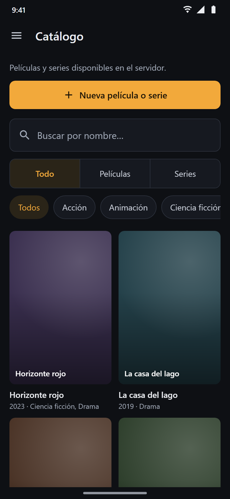
  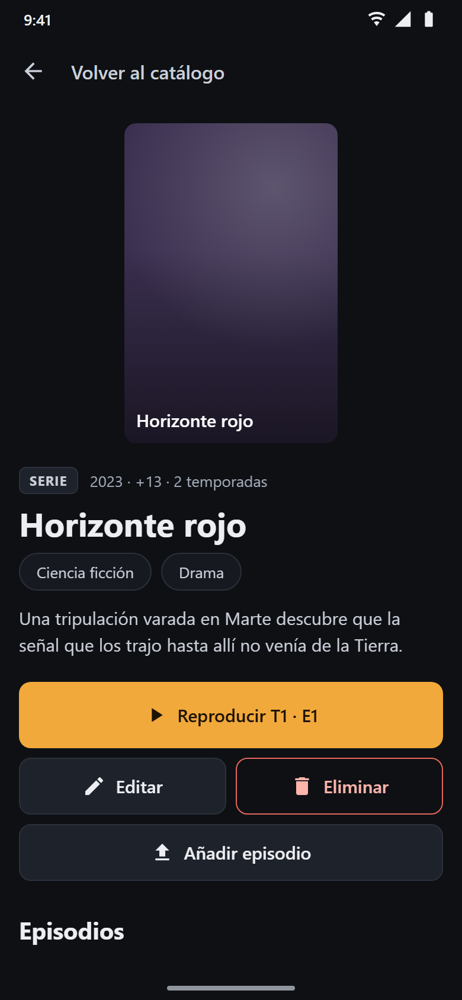
  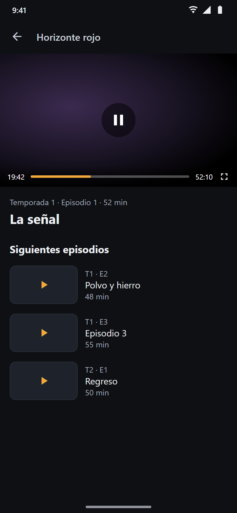
</p>

## Funcionalidades

**Para todos los usuarios (USER y ADMIN)**
- Catálogo con búsqueda por nombre, filtro por tipo (películas / series) y por género, cuadrícula de pósters y paginación. Los filtros se aplican en el servidor.
- Ficha de cada título: sinopsis, géneros, clasificación y episodios agrupados por temporada en pestañas.
- Reproductor de vídeo con la lista de siguientes episodios y paso automático al siguiente. En horizontal ocupa la pantalla completa.
- "Mi cuenta": editar datos personales, nombre de usuario y contraseña. El rol se muestra bloqueado.

**Solo administradores (ADMIN)**
- Gestión de películas y series: alta, edición, póster y borrado en cascada.
- Subida de episodios y vídeos (MP4/WEBM, hasta 10 GB) con barra de progreso y opción de cancelar.
- Gestión de géneros con edición en línea.
- Gestión de usuarios: alta, edición, cambio de rol y borrado. Las cuentas de otros administradores aparecen bloqueadas.

La sección "Administración" del menú lateral y los botones de crear, editar y eliminar solo se muestran a los administradores. Aun así, quien decide los permisos es el backend.

## Mockups

[`docs/mockups/index.html`](docs/mockups/index.html) es una **maqueta navegable** de la app: ábrela en el navegador y recorre las pantallas tocando los botones dentro del teléfono o desde el índice lateral. Las imágenes de abajo están exportadas de esa maqueta (en [`docs/mockups/png/`](docs/mockups/png/)) y usan datos de ejemplo.

| | | |
|---|---|---|
| **Inicio de sesión**<br>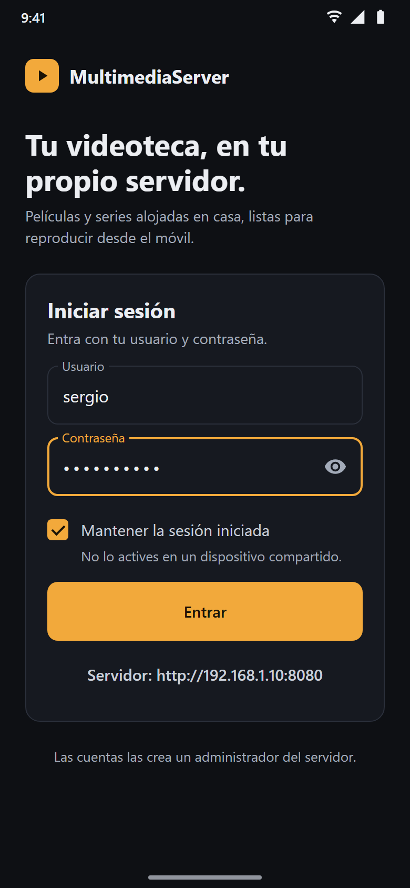 | **Catálogo**<br> | **Menú lateral**<br>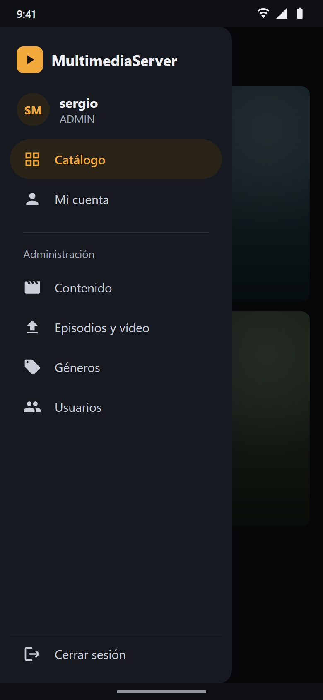 |
| **Detalle de serie**<br> | **Eliminar título**<br>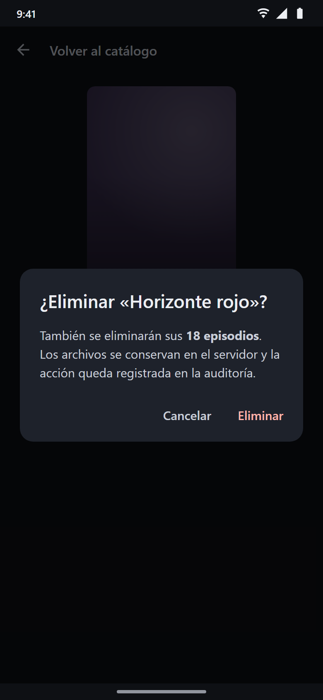 | **Reproductor**<br> |
| **Mi cuenta**<br>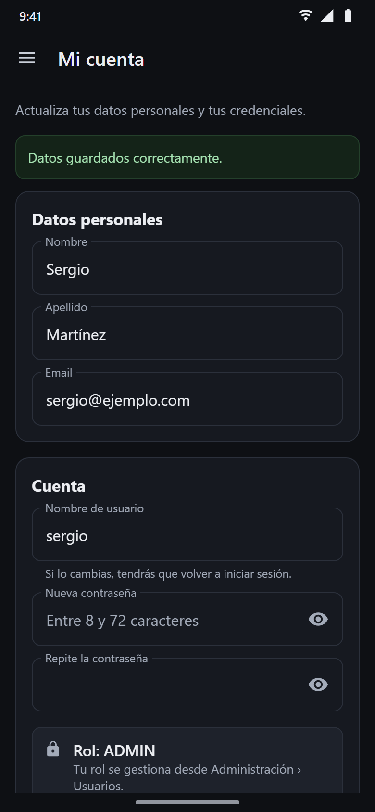 | **Administración · Contenido**<br>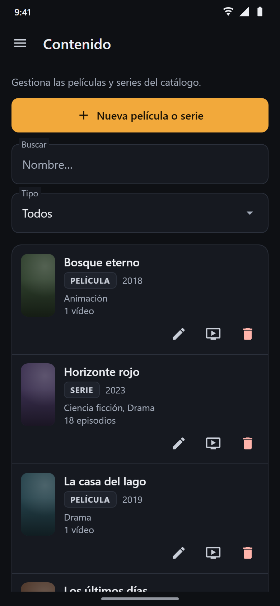 | **Administración · Editar título**<br>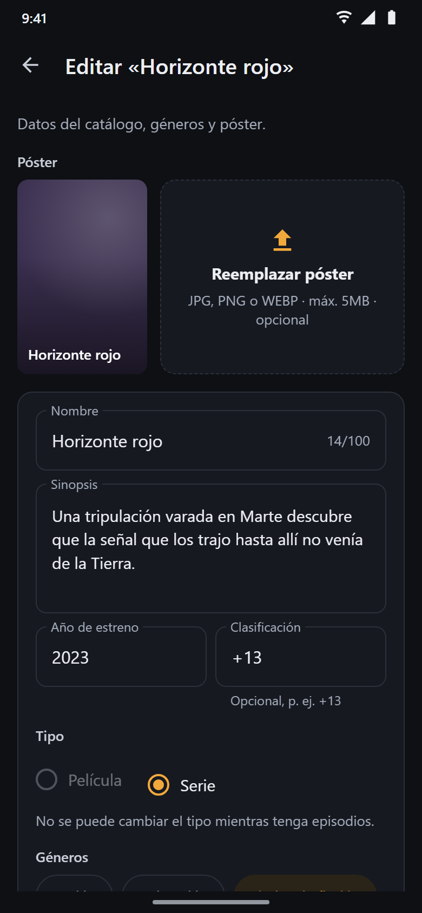 |
| **Administración · Episodios y vídeo**<br>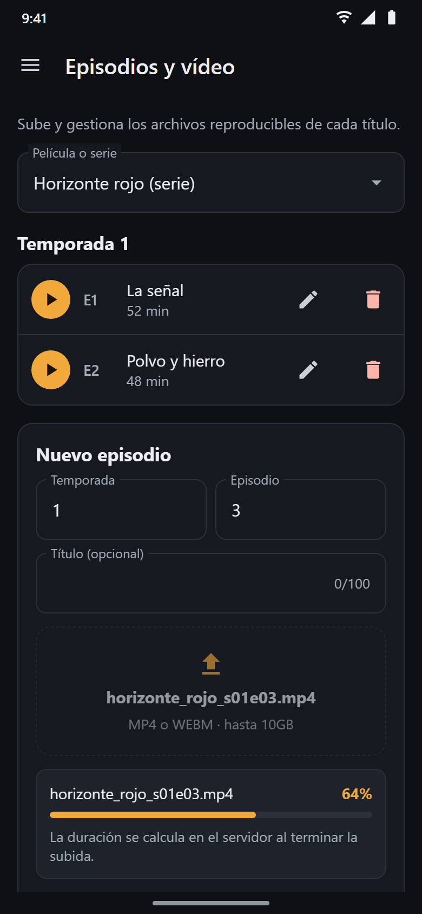 | **Administración · Géneros**<br>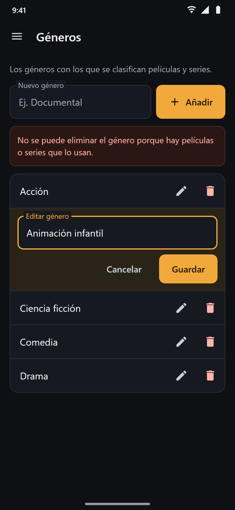 | **Administración · Usuarios**<br>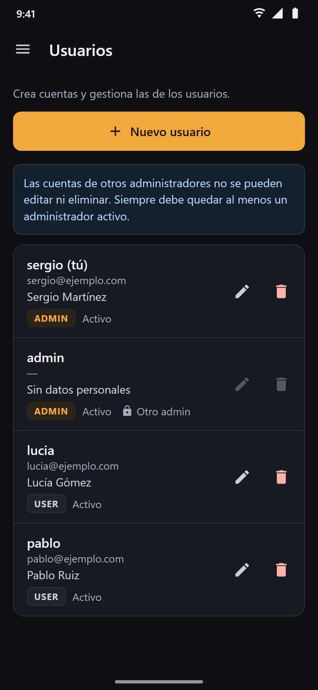 |
| **Administración · Nuevo usuario**<br>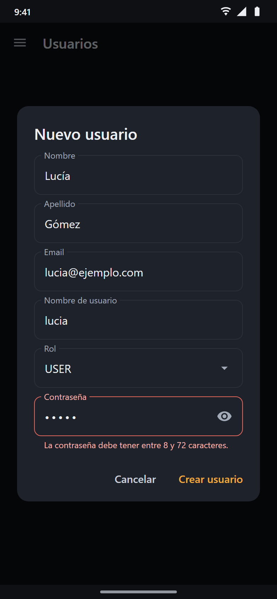 | | |

## Requisitos

- JDK 17 y el SDK de Android con la plataforma 37 (lo instala Android Studio). Gradle viene incluido (`gradlew`).
- Un móvil o emulador con Android 7.0 (API 24) o superior.
- El backend de MultimediaServer en marcha y accesible desde el móvil.

## Puesta en marcha

Abre la carpeta `Android/` en Android Studio y pulsa *Run*, o desde la terminal:

```bash
./gradlew installDebug
```

| Tarea | Qué hace |
|---|---|
| `./gradlew assembleDebug` | Genera `app/build/outputs/apk/debug/app-debug.apk` |
| `./gradlew installDebug` | Compila e instala la app en el dispositivo conectado |
| `./gradlew lintDebug` | Revisa el código con Android Lint |

Las cuentas las crea un administrador; no hay registro público.

## Configuración del servidor

El backend es autoalojado, así que su dirección cambia en cada instalación. En la pantalla de inicio de sesión, toca **"Servidor"** y escribe la dirección del backend; la app la recuerda.

| Dónde corre la app | Dirección |
|---|---|
| Emulador de Android Studio | `http://10.0.2.2:8080` (el PC anfitrión; es el valor por defecto) |
| Móvil real en la misma Wi-Fi | `http://<IP del PC>:8080`, por ejemplo `http://192.168.1.10:8080` |

Para generar el APK con otra dirección por defecto:

```bash
./gradlew assembleDebug -PapiUrl=http://192.168.1.10:8080
```

Si la app muestra "No se pudo conectar con el servidor", revisa que el móvil esté en la misma red y que el firewall del PC permita conexiones entrantes al puerto 8080. Como el servidor suele estar en la red local, la app permite HTTP sin cifrar.

## Seguridad de la sesión

- La contraseña **nunca se guarda**: solo vive en el formulario de inicio de sesión.
- Solo se guarda el **token JWT** (y el nombre de usuario), y únicamente lo gestiona [`api/Session.java`](app/src/main/java/com/multimediaserver/android/api/Session.java):
  - por defecto solo en memoria, así que la sesión termina al cerrar la app;
  - en el almacenamiento privado de la app si se marca "Mantener la sesión iniciada" (no recomendado en dispositivos compartidos). La copia de seguridad en la nube está desactivada.
- Cada petición envía `Authorization: Bearer <token>`. Un token caducado nunca se envía: la sesión se cierra justo cuando vence (`exp` del JWT) y ante cualquier respuesta 401.
- El vídeo es la única excepción: su URL lleva `?token=`, como exige la API.

## Estructura del proyecto

```
app/src/main/
├── java/com/multimediaserver/android/
│   ├── MultimediaApp.java  # Inicialización y cierre de sesión ante un 401
│   ├── api/                # Cliente HTTP (OkHttp), sesión, URL del servidor y un grupo de llamadas por recurso
│   ├── model/              # DTOs de la API (Gson)
│   ├── util/               # Tareas en segundo plano, formato, caché de géneros y de pósters
│   └── ui/
│       ├── MainActivity    # Menú lateral que aloja las pantallas principales
│       ├── common/         # Alertas, estados, paginación, diálogos, póster, márgenes del sistema
│       ├── auth/           # Inicio de sesión
│       ├── catalog/        # Catálogo y detalle de títulos
│       ├── player/         # Reproductor
│       ├── account/        # Mi cuenta
│       └── admin/          # Contenido, formulario de título, episodios y vídeo, géneros y usuarios
└── res/                    # Layouts, colores (mismos tokens que la web), estilos e iconos
```

Las convenciones del proyecto y las decisiones de implementación están en [`CLAUDE.md`](CLAUDE.md). El contrato de la API está en [`../Frontend/CLAUDE.md`](../Frontend/CLAUDE.md).

## Tecnologías

Java 17 · Android SDK 37 (mínimo API 24) · [Material Components](https://github.com/material-components/material-components-android) · AndroidX (AppCompat, RecyclerView, ConstraintLayout, SwipeRefreshLayout) · [OkHttp](https://square.github.io/okhttp/) · [Gson](https://github.com/google/gson) · Gradle 9 con el plugin de Android 9.4
